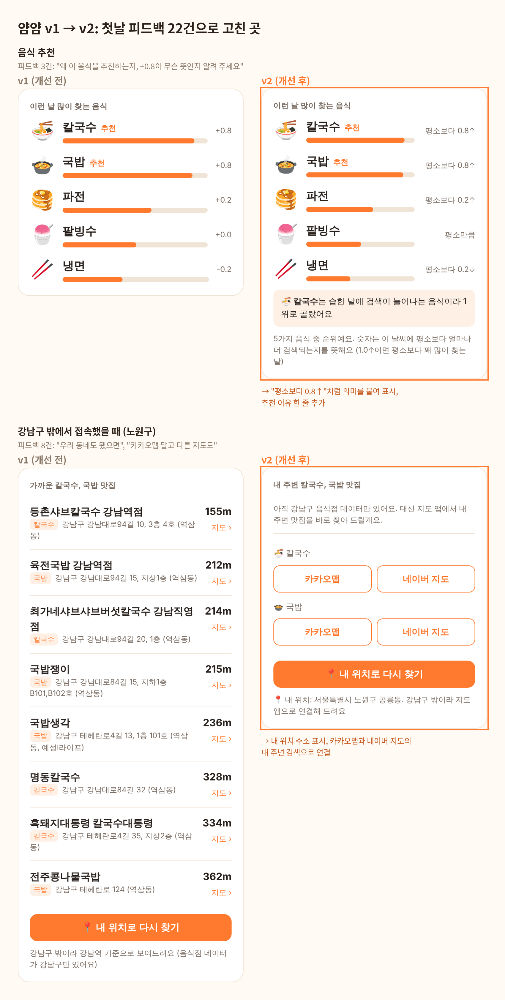

# 얌얌, 오늘 뭐 먹지? (yamyam-web)

**날씨로 오늘 먹을 음식과 가까운 맛집을 추천하는 웹 서비스**

검색 트렌드와 기상 데이터로 학습한 추천 모델을 실제 서비스로 배포하고, **실제 사용자 피드백 22건을 모아 v2로 개선한 뒤, 8건의 추가 피드백으로 다음 문제를 찾은** 프로젝트입니다.

- 서비스: https://hwasun-zip.github.io/yamyam-web/
- 이전 버전: [v1](https://hwasun-zip.github.io/yamyam-web/v1.html), [v2](https://hwasun-zip.github.io/yamyam-web/v2.html)
- 모델 분석: [yamyam](https://github.com/hwasun-zip/yamyam)
- 서버 코드: [yamyam-server](https://github.com/hwasun-zip/yamyam-server)

<br>

## 핵심 결과

| 항목 | 결과 |
|---|---|
| 배포 | 10/23 오전 v1 배포, 지인 단톡방과 인스타그램으로 공유 |
| 첫날 반응 | 설문 응답 **22건**, 서술형 의견 **18건**, 👍 21 / 👎 0 |
| 만족도 | 추천 음식 만족도 평균 **3.8 / 5**, 다시 쓰겠다 **20명 (91%)** |
| 가장 많은 불만 | 서술형 18건 중 **8건**이 "강남구 밖 지역도 됐으면" |
| 개선 | 같은 날 밤 v2 배포. 피드백 상위 문제 4가지를 데이터 추가 없이 해결 |
| v2 결과 | 지역 관련 의견 비중 **44% → 13%**, 만족도 **3.8 → 4.1**. 강남구 밖 접속 10회에서 내 주변 지도 검색 **9회** |
| 다음 문제 | v2 의견 8건 중 **6건(75%)**이 음식 종류 확대 요청. 가장 큰 불만이 지역에서 메뉴로 옮겨감 |
| v3 | 재학습 전 가장 작은 해결로, 원하는 음식을 눌러 그 음식의 맛집을 보는 기능 배포 |

<br>

## 서비스 소개

1. 접속한 위치의 오늘 날씨(기온, 강수량, 습도, 풍속)를 불러옵니다.
2. 날씨로 5가지 음식(국밥, 칼국수, 냉면, 파전, 팥빙수)의 검색량을 예측하고, 평소보다 많이 찾는 순서로 보여줍니다.
3. 상위 2개 음식을 파는 가까운 음식점을 거리순으로 추천합니다.

- 모델: 네이버 데이터랩 검색 트렌드와 기상청 날씨로 학습한 음식별 선형 회귀
- 음식점: 서울시 일반음식점 인허가 데이터 중 강남구 194곳
- 서버 없이 브라우저에서 모델을 바로 실행하도록 GitHub Pages에 정적 배포

<br>

## 1단계. 피드백을 모으는 장치 만들기

배포 전에 "무엇을 했는지"와 "왜 그랬는지"를 함께 볼 수 있게 두 가지를 붙였습니다.

| 도구 | 알 수 있는 것 |
|---|---|
| GoatCounter (방문, 클릭 집계) | 페이지 열림, 버튼별 클릭 수, 유입 경로, 기기 |
| Google Forms (1분 설문) | 추천 만족도, 가 보고 싶은 곳 여부, 써 본 기능, 서술형 의견, 재사용 의향 |

- 👍 👎 버튼 아래에 설문 링크를 연결했고, 👎를 누르면 설문 버튼이 더 눈에 띄게 바뀝니다.
- 본인 방문은 집계에서 제외했습니다.

<br>

## 2단계. 첫날 반응 (v1, 10/23 22시 기준)

**행동 데이터 (GoatCounter)**

| 항목 | 수 |
|---|---|
| 페이지 열림 | 33 (배포 확인용 9 포함) |
| 날씨 바꿔 보기 (무더운 날, 비 오는 날, 추운 날) | 60 |
| 내 위치로 찾기 | 18 |
| 지도 열기 | 12 |
| 휴대폰 접속 비율 | 79% |

**설문 (22건)**

| 질문 | 결과 |
|---|---|
| 추천 음식이 먹고 싶은 음식과 맞았나 | 평균 3.8 / 5 |
| 가 보고 싶은 곳이 있었나 | 있었다 17, 너무 멀었다 4, 없었다 1 |
| 다시 써 볼 것 같나 | 네 20, 잘 모르겠다 2 |

<br>

## 3단계. 서술형 의견 18건을 주제별로 묶기

| 주제 | 건수 | 대표 의견 | v2 반영 |
|---|---|---|---|
| 지역 확대 | **8** | "우리 지역은 없어요ㅠㅠ" | ✅ |
| 음식 종류, 전체 메뉴 수 | 5 | "추천되는 메뉴가 총 몇 가지인지 알 수 없어요" | 일부 |
| 개인 취향, 회원 기능 | 4 | "매운맛 같은 취향을 고려했으면" | 다음 단계 |
| 다른 지도 앱, 페이지 안 지도 | 4 | "구글이나 네이버맵 이용자는 불편할 것 같아요" | ✅ |
| 추천 이유, 점수 의미 | 3 | "메뉴 옆 +0.6이 무슨 의미인지 나오면 좋겠어요" | ✅ |
| 한식, 일식 같은 분류 | 3 | "국물, 밥, 양식, 한식 등 구분되면 좋을 것 같아요" | 다음 단계 |
| 리뷰 | 2 | "이용한 사람들이 남길 수 있는 리뷰창" | 다음 단계 |
| 위치 버튼 오류 | 1 | "두 번째로 누르면 위치 권한이 없다고 떠요" | ✅ |

**우선순위를 정한 기준**
- 많이 나온 문제부터, 그리고 **새 데이터 수집이나 모델 재학습 없이** 바로 고칠 수 있는 것부터 반영했습니다.
- 음식 종류 확대와 취향, 리뷰 기능은 검색 트렌드 재수집과 재학습, 회원 데이터 관리가 필요해 다음 단계로 미뤘습니다.

<br>

## 4단계. v2에서 고친 것



| 문제 | v1 | v2 |
|---|---|---|
| 강남구 밖 사용자 | 강남역 기준 목록만 보여줌 | 내 위치 주소를 보여주고, 추천 음식으로 **카카오맵과 네이버 지도의 내 주변 검색**을 바로 연결. 날씨도 실제 내 위치 기준 |
| 점수의 의미 | "+0.8"만 표시 | "평소보다 0.8↑"처럼 방향과 크기를 함께 표시하고, 기준(1.0↑이면 꽤 많이 찾는 날)을 안내 |
| 추천 이유 | 없음 | "칼국수는 습한 날에 검색이 늘어나는 음식이라 1위로 골랐어요"처럼 가장 크게 작용한 날씨 요인을 한 줄로 설명 |
| 지도 앱 | 카카오맵만 | 음식점마다 카카오맵과 네이버 지도 |
| 위치 오류 | 시간 초과도 "권한 없음"으로 표시 | 오류 종류별로 안내하고 확인 시간을 늘림 |

**추천 이유를 만드는 방법**: 서울의 평균적인 날씨와 비교해, 1위 음식의 예측 검색량을 가장 크게 끌어올린 날씨 요인(기온, 강수량, 습도, 풍속)을 골라 문장으로 보여줍니다.

<br>

## 5단계. v2 이후 반응 (10/27 기준)

v2는 10/23 22:44에 배포했고, 그 이후의 설문 응답과 클릭을 v1과 나눠서 봤습니다.

**설문**

| 항목 | v1 (22건) | v2 (8건) |
|---|---|---|
| 추천 만족도 평균 | 3.8 / 5 | 4.1 / 5 |
| "가 보고 싶었지만 너무 멀었어요" | 4건 (18%) | 1건 (13%) |
| 서술형 중 지역 관련 의견 | 8 / 18건 (44%) | 1 / 8건 (13%) |
| 지도 보기까지 써 본 사람 | 9명 (41%) | 7명 (88%) |
| 다시 쓰겠다 | 91% | 100% |

**새 기능 클릭 (GoatCounter)**

| 기능 | 클릭 |
|---|---|
| 강남구 밖에서 접속 (`out-of-area`) | 10 |
| 내 주변 찾기 (`near-naver`, `near-kakao`) | 네이버 5, 카카오 4 |
| 음식점 지도 열기 | 네이버 4, 카카오 3 |

- 강남구 밖 접속 10회에서 내 주변 지도 검색이 9회 나와, v1에서 "너무 멀었어요"로 멈추던 사용자가 다음 단계로 넘어갔습니다.
- v2 이후 지도 클릭 16회 중 9회(56%)가 네이버 지도였습니다. "다른 지도 앱도" 의견이 실제 수요였다는 근거입니다.

**서술형 의견 8건**

| 주제 | 건수 | 대표 의견 |
|---|---|---|
| v2에서 고친 기능이 좋았다 | 5 | "우리 동네도 됐으면 좋겠다고 했는데 해주셨어요! 집에서 엄청 가까운데 몰랐던 맛집 발견해서 얼큰한 국밥 먹었습니다" |
| **음식 종류 확대** | **6** | "상위 1, 2위인 칼국수랑 국밥만 있어서 아쉬웠어요. 오늘 날씨가 흐려서 파전이랑 붕어빵도 먹고 싶었는데!" |
| 분류, 정렬 | 2 | "주변 맛집 리스트를 음식별로 나눠 보고 싶어요" |
| 음식 사진, 아이콘 | 2 | "음식점 이름에 대표 음식 사진이 있으면 침샘을 더 자극할 것 같아요" |
| 점수 크기 | 1 | "1.0이 꽤 많이 증가한 수치라는데 1이 주는 느낌은 작아요" |
| 지역 확대 | 1 | "동네도 늘어나면 좋을 것 같아요" |

- 추천을 보고 실제로 가까운 국밥집에 다녀왔다는 응답이 2건 나왔습니다.
- **가장 큰 불만이 지역(v1 44%)에서 음식 종류(v2 75%)로 옮겨갔습니다.** 첫 번째 병목을 풀자 다음 병목이 드러났고, 이것이 다음 개선의 1순위입니다.

<br>

## 6단계. v3: 음식 종류 요청에 대한 가장 작은 해결 (10/27)

음식 종류를 늘리려면 검색 트렌드를 다시 모으고 모델을 재학습해야 합니다. 그 전에 지금 할 수 있는 가장 작은 해결을 먼저 배포했습니다.

**의견을 다시 읽어 보니** "칼국수랑 국밥만 있어서 아쉬웠어요. 파전도 먹고 싶었는데"처럼, 메뉴가 아예 없어서라기보다 **상위 2개 음식의 맛집만 볼 수 있어서** 생긴 불만도 섞여 있었습니다. "주변 맛집 리스트에서 두 음식이 합쳐져서 나온다"는 의견도 같은 원인이었습니다.

| v2 | v3 |
|---|---|
| 1, 2위 음식의 맛집만 섞어서 보여줌 | **음식을 누르면 그 음식의 맛집만** 보여주고, 다시 누르면 추천 2개로 돌아감 |

- 강남구 밖 사용자에게도 고른 음식으로 지도 앱 검색을 연결합니다.
- 새 클릭 집계 `food-pick`으로, 추천 1, 2위가 아닌 음식을 직접 고르는 사용자가 얼마나 되는지 확인합니다. 이 숫자가 음식 종류 확대의 우선순위를 판단하는 근거가 됩니다.

<br>

## 한계

- 응답자 대부분이 지인이라 만족도와 👍가 후하게 나왔을 수 있습니다. 그래서 버튼 수보다 서술형 의견을 기준으로 개선점을 정했습니다.
- v2 응답은 8건으로 적고, 첫날 의견을 남긴 지인에게 다시 부탁한 응답이 포함됩니다. 그래서 만족도 상승보다 "고친 문제에 대한 불만이 사라지고, 고친 기능이 실제로 쓰였다"는 확인으로 해석했습니다.
- 클릭 수에는 같은 사람의 반복 클릭과 본인 확인이 섞여 있을 수 있어, 비율보다 사용 여부를 확인하는 용도로 봤습니다.
- 설문 응답(22)이 설문 열기 클릭(14)보다 많은데, 설문 링크를 따로 공유한 경우도 있어 방문 대비 응답률로는 해석하지 않았습니다.
- 추천 모델은 계절과 날씨의 영향을 완전히 분리하지 못했습니다. 자세한 내용은 [yamyam](https://github.com/hwasun-zip/yamyam)에 정리했습니다.

<br>

## 다음 단계

v2 의견에서 우선순위가 바뀌었습니다.

1. **음식 종류 확대** (v2 의견 8건 중 6건): v3의 `food-pick` 결과를 보고 검색 트렌드를 다시 모아 음식을 늘리기
2. 분류와 정렬 (한식, 일식, 국물, 밥 등)
3. 서울 전체 음식점 데이터로 확장 (v2에서는 지도 앱 연결로 우회)

<br>

## 파일 구성

```
yamyam-web/
├── index.html          # 현재 서비스 (v3)
├── v1.html             # 이전 버전 보관 (집계 제외)
├── v2.html             # 이전 버전 보관 (집계 제외)
├── v1_v2_compare.png   # 개선 전후 비교
└── README.md
```

**사용 기술**: HTML, CSS, JavaScript, GitHub Pages, Open-Meteo API, OpenStreetMap Nominatim, GoatCounter, Google Forms
